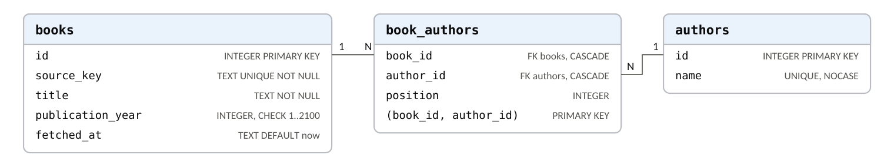
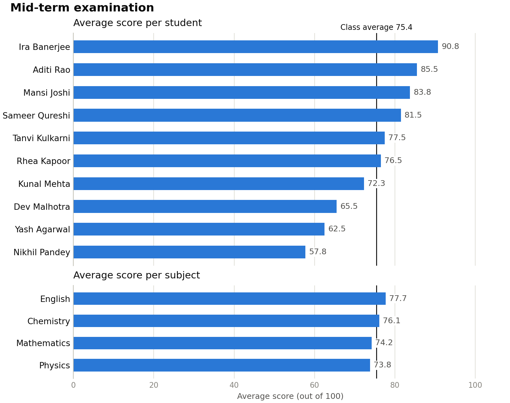
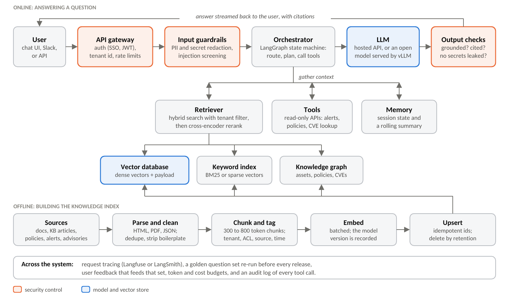
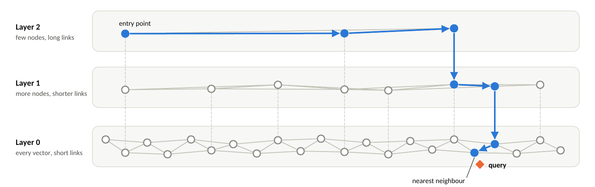
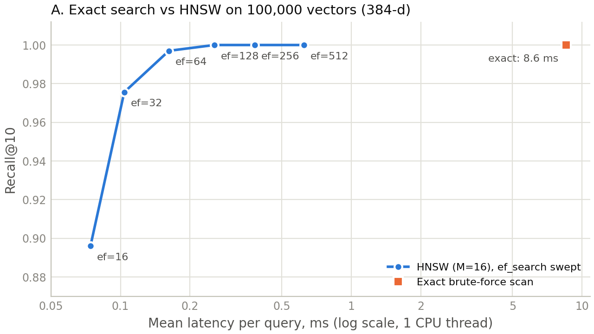
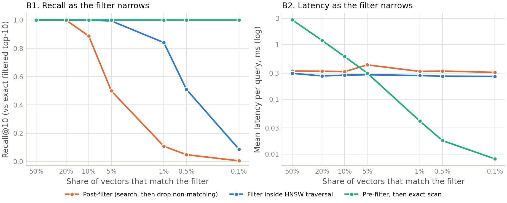

# AccuKnox AI/ML Trainee assignment: answers

Faleha Qazi. The same content, formatted for print, is in [Faleha_Qazi_AccuKnox_AIML_Assignment.pdf](Faleha_Qazi_AccuKnox_AIML_Assignment.pdf).

This document answers both problem statements. Part A covers the three Python tasks and links to my most complex Python and database work. Part B answers the three written questions. For the vector database question I ran two small experiments instead of only describing the trade-offs, and I used what they showed to make the final choice.

## Part A. Problem Statement 1

All three tasks live in one small project (Python 3.9+, with `requests`, `pandas` and `matplotlib`). Each task is one script with a command-line interface. A shared `common.py` holds the HTTP session, which sets a timeout on every request and retries 429 and 5xx responses with exponential backoff, and the SQLite connection helper, which switches foreign-key enforcement on (SQLite leaves it off by default). The project has 31 pytest tests that run against a throwaway HTTP server on localhost, so they need no internet. The code passes `ruff` and `mypy`.

```console
$ pip install -r requirements.txt
$ pytest -q
...............................                                                              [100%]
31 passed in 8.07s
```

### A1. Task 1: API data retrieval and storage

Code: [task1_books.py](task1_books.py)

I used the [Open Library Search API](https://openlibrary.org/dev/docs/api/search) because it is public, needs no key, and returns the attributes the task names: a title, the author names, and the year the work was first published. The script requests only those fields, pages through the results until it has as many books as asked for, stores them in SQLite, and prints what is stored.

The schema took the most thought. Books and authors are many-to-many (Design Patterns has four authors, and most authors have several books), so they get their own tables plus a link table that also records the credited author order (Figure 1). A single table with an author text column would repeat names and turn "all books by X" into a `LIKE` query. Each book is keyed on Open Library's work id and written with an upsert (`INSERT ... ON CONFLICT DO UPDATE`), so running the script twice updates rows instead of duplicating them. When a book comes back with a different author list, its old links are deleted first, so nothing stale survives. The rules live in the database as well as in Python: `NOT NULL` and `CHECK` constraints, foreign keys with `ON DELETE CASCADE`, case-insensitive unique author names, and indexes on the publication year and on the link table's author column. Each run is one transaction, so either every book from it is stored or none is.

The API side assumes the network will sometimes fail. Every request has a timeout, 429 and 5xx responses are retried with exponential backoff, and paging stops if a page adds nothing new, which protects against an API that ignores the page parameter and keeps returning the same results. If the API stays down, the script prints a clear error and exits with a non-zero code. Hits without a title are skipped and counted, and a missing author or year is left empty rather than invented.



*Figure 1. Task 1 schema. Indexes exist on `books(publication_year)` and `book_authors(author_id)`; both foreign keys cascade on delete.*

The sample run below points the script at the test fixture, an Open Library-style response served from localhost, so the output can be reproduced exactly. Against the live API the same script prints the current catalogue. A second run prints the same table: the database still holds 8 books and 13 authors.

```console
$ python task1_books.py --query programming --api-url http://127.0.0.1:8765/search.json
INFO    Skipped 1 result(s) without a key or title
INFO    Saved 8 book(s) for query 'programming' into output/books.db
Year  Title                                           Author(s)
----------------------------------------------------------------------------------------------
1978  The C Programming Language                      Brian W. Kernighan, Dennis M. Ritchie
1985  Structure and Interpretation of Computer Pr...  Harold Abelson, Gerald Jay Sussman
1994  Design Patterns                                 Erich Gamma, Richard Helm, Ralph John...
1999  The Pragmatic Programmer                        Andrew Hunt, David Thomas
2015  Automate the Boring Stuff with Python           Al Sweigart
2015  Fluent Python                                   Luciano Ramalho
2015  Python Crash Course                             Eric Matthes
n/a   Programming Notes                               Unknown

8 book(s) by 13 author(s) in output/books.db
```

### A2. Task 2: data processing and visualization

Code: [task2_scores.py](task2_scores.py) and [mock_scores_api.py](mock_scores_api.py)

No public API serves student test scores, so I wrote a small one. `mock_scores_api.py` serves `data/students.json` at `GET /api/students` using only the standard library. The client treats it like any other remote API: it fetches over HTTP with the same retrying session, and `--url` points it at any endpoint that returns the same JSON shape. Run with no arguments, the script starts the bundled API on a free port, fetches the data, and shuts the API down.

```json
{
  "exam": "Mid-term examination",
  "max_score": 100,
  "students": [
    {"id": 1, "name": "Aditi Rao",
     "scores": {"Mathematics": 88, "Physics": 79, "Chemistry": 84, "English": 91}},
    {"id": 4, "name": "Kunal Mehta",
     "scores": {"Mathematics": 72, "Physics": 77, "Chemistry": "AB", "English": 68}},
    ...  8 more students
  ]
}
```

pandas flattens the payload to one row per student and subject and does the grouping. The dataset marks one absence as `"AB"`. That score, and anything non-numeric or outside 0 to `max_score`, is logged and left out of the averages. Counting the absence as zero would drop that student's average from 72.3 to 54.3 for a test he never sat. The class average is the mean of all 39 usable scores (75.44), and the script also reports averages per student and per subject. Students are grouped by id as well as name, so two students who share a name stay separate.



*Figure 2. Output of `task2_scores.py`. Both panels share one axis, so the class-average line (75.4) reads straight down through them.*

```console
$ python task2_scores.py
INFO    Fetching scores from http://127.0.0.1:35705/api/students
WARNING Ignoring Kunal Mehta's Chemistry score: 'AB'
Mid-term examination: 39 scores from 10 students, 1 ignored
Class average: 75.44 / 100

Student            Average
Ira Banerjee         90.75
Aditi Rao            85.50
Mansi Joshi          83.75
Sameer Qureshi       81.50
Tanvi Kulkarni       77.50
Rhea Kapoor          76.50
Kunal Mehta          72.33
Dev Malhotra         65.50
Yash Agarwal         62.50
Nikhil Pandey        57.75

Subject            Average
English              77.70
Chemistry            76.11
Mathematics          74.20
Physics              73.80

Chart saved to output/scores_chart.png
```

### A3. Task 3: CSV data import to a database

Code: [task3_csv_import.py](task3_csv_import.py)

The importer streams the CSV, cleans and validates each row, and writes the valid rows in batches inside a single transaction. I put the usual problems of real exports into the sample file:

| Rule | Example in `data/users.csv` | Result |
| --- | --- | --- |
| Trim names and collapse inner spaces; trim and lower-case emails | `"  Sneha   Iyer "`, `"Sneha.Iyer@Example.com"` | Stored as `Sneha Iyer`, `sneha.iyer@example.com` |
| A name is required | `,no.name@example.com` (line 10) | Rejected, reported with its line number |
| The email must look like an address | `meera.nair@example` (line 9), `arjun.das(at)example.com` (line 14) | Rejected, reported with its line number |
| One user per email, ignoring case | `AARAV.SHARMA@example.com` (line 12) | Skipped as already present |
| Quoted commas inside a field | `"D'Souza, Neha"` | Parsed as one name |
| Excel's byte-order mark; headers in any case or order | `Email, NAME` saved by Excel (covered by a test) | Read correctly |

Email is the natural key. The column is `UNIQUE COLLATE NOCASE` and the insert uses `ON CONFLICT (email) DO NOTHING`, so importing the same file a second time adds nothing. With `--on-conflict update` the CSV wins instead, and only rows whose name actually changed are touched, which keeps `updated_at` meaningful. Valid rows go in with `executemany` in batches of 1,000 inside one transaction, which is fast on a large file and means a failure halfway through leaves the table as it was. The summary counts come from the database itself: new rows from `COUNT(*)` before and after, updates from SQLite's change counter, and the remainder were already present. A bad row is reported with its line number, and the import carries on.

```console
$ python task3_csv_import.py data/users.csv
WARNING Line 9 rejected: invalid email 'meera.nair@example'
WARNING Line 10 rejected: name is empty
WARNING Line 14 rejected: invalid email 'arjun.das(at)example.com'
15 rows read: 11 inserted, 0 updated, 1 already present, 3 rejected
11 user(s) now in output/users.db
$ python task3_csv_import.py data/users.csv    # same file again
WARNING Line 9 rejected: invalid email 'meera.nair@example'
WARNING Line 10 rejected: name is empty
WARNING Line 14 rejected: invalid email 'arjun.das(at)example.com'
15 rows read: 0 inserted, 0 updated, 12 already present, 3 rejected
11 user(s) now in output/users.db
```

### A4. My most complex Python code

Link: [github.com/Falehaqazi/AutoAuth-Clinical-Agent](https://github.com/Falehaqazi/AutoAuth-Clinical-Agent)

AutoAuth is a decision-support agent for clinical prior authorization. The repository also holds SynthPA-60, the 60-case benchmark built to test it, and the evaluation code. It is about 2,700 lines of Python, and the parts that took the most care were:

- `backend/agent.py`: a six-node LangGraph state machine (redact, retrieve, reason, tools, critique, finalize) with a typed state. Identifiers are redacted before retrieval or any network call. The reasoning step runs a ReAct loop with CPT and ICD-10 lookup tools, a separate critique step can send a draft back for revision within a budget, and four escalation rules are enforced in code on the parsed output, so the system cannot issue a denial on its own.
- `backend/policy_store.py`: retrieval over twelve synthetic payer policies, chunked and embedded with all-MiniLM-L6-v2 into a FAISS index.
- `eval_autoauth.py`: an evaluation harness built to survive free-tier API limits. It writes results to append-only JSONL, resumes after a crash, and retries with exponential backoff. Scoring includes cluster-bootstrap confidence intervals (seeds of the same case resample together), paired differences between configurations, and risk-coverage curves.
- `analyze_synthpa60.py`: about 800 lines of analysis: Wilson intervals, AUROC with bootstrap intervals, expected calibration error, McNemar tests, and the figures and LaTeX tables for the write-up.

The result is the part I learned most from. Across three seeds and 180 case-runs, the confidence gate did not change a single outcome: 88 of the 89 escalations came from one rule in code that does not read the model's confidence at all. I come back to this in B2.

### A5. My most complex database code

Link: [github.com/CodeGraphContext/CodeGraphContext/pull/1630](https://github.com/CodeGraphContext/CodeGraphContext/pull/1630) (merged, August 2026)

CodeGraphContext is an open-source MCP server and CLI that indexes source code into a graph database (Neo4j, FalkorDB, KuzuDB and others) so AI assistants can query call chains and dependencies. Issue #1393: a symbol's node identity was the triple (name, path, line number), which is not unique. A grouped CSS rule such as `tfoot th, tfoot td { }` emits two `tfoot` symbols on one line, and a minified JS bundle puts every function on line 1. The `MERGE` collapsed those distinct symbols into one node, and the following `SET n += row` silently overwrote the first symbol's properties with the last one's.

My fix (commit `e3b8687`, 360 lines added across five files, including a 201-line regression test):

- A per-file `occurrence_index`, assigned deterministically in parse order so it is stable across re-indexing. It is 0 for every symbol in a file without collisions, which leaves the identity of the vast majority of nodes unchanged.
- The index became part of the `MERGE` and `MATCH` key and of the composite indexes behind them.
- A schema migration: the old three-property `UNIQUE` constraints made the fix impossible (the database refused to create the second node), so they are dropped and replaced by four-property identity constraints under new names, which keeps the drop a no-op on later start-ups. Rebuilding a constraint on a large graph is expensive.
- The parameter-linking step's de-duplication key gained the same field. Without it, two colliding functions that share an argument name would collapse to one row, and only one of them would get its parameter edge.
- Labels that are global by design (`Module`, `DbTable`, `ExternalClass`) keep their name-only identity.

```python
# writer.py (excerpt): occurrence_index joins the MERGE key for positional labels
node_key = (
    "name: row.name, path: $file_path, "
    "line_number: row.line_number, "
    "occurrence_index: row.occurrence_index"
)
merge_clause = f"MERGE (n:{label} {{{node_key}}})"

# schema.py (excerpt): drop the 3-property constraints, add 4-property identity ones
for _label, _legacy_name in _LEGACY_IDENTITY_CONSTRAINTS.items():
    ddl.run(f"DROP CONSTRAINT {_legacy_name} IF EXISTS")
for _label, _var in POSITIONAL_IDENTITY_LABELS.items():
    _constraint = f"{_label.lower()}_identity"
    ddl.run(
        f"CREATE CONSTRAINT {_constraint} IF NOT EXISTS "
        f"FOR ({_var}:{_label}) REQUIRE "
        f"({_var}.name, {_var}.path, {_var}.line_number, "
        f"{_var}.occurrence_index) IS UNIQUE"
    )
```

The maintainer merged it as an advanced-level contribution after extending the same identity scheme to the embedded Kùzu backend and a few more node types. Outside open source, my internship at Tech Mahindra Makers Lab included a Django internship-management portal built on a normalised PostgreSQL schema with role-based access control.

## Part B. Problem Statement, assignment 2

### B1. Self-rating

A = can code independently; B = can code under supervision; C = little or no understanding.

| Area | Rating | What the rating rests on |
| --- | --- | --- |
| LLM | A | Designed, built and evaluated LLM systems end to end: AutoAuth (LangGraph agent, FAISS retrieval, tool calling, critique loop, three-seed evaluation), ClinTask (four cooperating agents on Google ADK and Gemini, deployed on Cloud Run), and a bilingual voice agent for appointment confirmation. |
| Deep learning | B | At Tech Mahindra Makers Lab I fine-tuned Florence-2, a vision-language model, with LoRA on 996 annotated engineering drawings, and added elastic weight consolidation and a replay buffer to limit catastrophic forgetting. My deep learning work so far has been adapting pretrained models rather than designing and training new architectures, and for that I would want a reviewer at first. |
| AI | A | Agentic systems and the safety logic around them, such as AutoAuth's escalation rules, plus the benchmark and evaluation used to test them. Also a merged fix in CodeGraphContext, an open-source code-graph tool for AI coding assistants. |
| ML | A | scikit-learn models in my own projects, such as an Isolation Forest that flags implausible vital signs in FHIRGuard, and the evaluation statistics I used in AutoAuth: AUROC with bootstrap intervals, calibration error and McNemar tests. |

### B2. Architecture of an LLM-based chatbot

The LLM is only one component of a production chatbot, and most of the engineering goes into the parts around it. I explain those parts with an example close to AccuKnox's domain: an assistant that answers a security engineer's questions, such as *"Why was curl blocked in the payments namespace last night?"*, using product documentation, the customer's own policies and its runtime alerts.



*Figure 3. Components of an LLM chatbot with retrieval and tools. The top lane runs for every question; the bottom lane keeps the knowledge index current.*

#### The components

| Component | What it does | Choices I would consider |
| --- | --- | --- |
| API gateway | Authenticates the user and attaches tenant and role; enforces rate limits. | SSO/OIDC and JWT. The tenant comes from the token, never from the chat text. |
| Input guardrails | Redact personal data and secrets before anything leaves the boundary; screen for prompt injection and off-topic requests. | Presidio-style recognisers and regexes for keys; a small classifier such as Llama Guard, or a zero-shot classifier built with Scikit-LLM. |
| Orchestrator | Holds conversation state, classifies intent, plans the steps, calls retrieval and tools, and stops when done or when the step budget runs out. | A LangGraph state machine. Explicit nodes and edges are easier to test and bound than a free-running agent. |
| Retriever | Finds the few passages that answer the question, only from data this user may see. | Hybrid dense and keyword search fused with reciprocal rank fusion [7], metadata filters (tenant, namespace, time), then a cross-encoder reranker. |
| Knowledge stores | Hold chunks with their metadata; answer relational questions. | A vector database (B3), BM25 or sparse vectors, and a knowledge graph for questions like "which internet-facing workloads run an image with this CVE and have no runtime policy?", which similarity search answers badly [9]. |
| Tools | Fetch live facts the index cannot hold, such as last night's alerts or the current policy. | Read-only APIs with typed arguments validated in code. Anything that changes state comes back as a proposal for a human to approve. |
| Memory | Keeps multi-turn context within the token budget. | The last few turns plus a rolling summary; long-term facts stored like documents and scoped to the tenant. |
| LLM | Writes the answer, or picks the next action. | A hosted API to start, for quality and speed of iteration. An open-weight model (the Llama family named in the job description, Mistral, Qwen) served with vLLM [8] where data cannot leave the customer's cloud. A small model for routing. |
| Output checks | Verify the answer before the user sees it. | Every claim must cite a retrieved source; tool calls must match their schema; a final scan for secrets and personal data; a refusal when there is nothing to ground the answer in. |
| Observability and evaluation | Show whether it works, and keep it working after changes. | Per-request traces (Langfuse or LangSmith), a golden question set, RAG metrics such as faithfulness and context recall, user feedback, cost dashboards. |

#### One question, end to end

1. The gateway authenticates the engineer and attaches tenant `T` from the token.
2. Input guardrails redact any key or token pasted into the message and screen it for injection.
3. The orchestrator classifies the question as an alert investigation and plans two steps: retrieve the relevant policy and documentation, and call the alerts API.
4. The retriever runs a hybrid search filtered to `tenant = T` and `namespace = payments`, reranks the top 50 passages, and keeps 8, each with a source id.
5. The read-only alerts tool returns last night's events for the namespace: `/usr/bin/curl`, blocked by policy *P*.
6. The prompt is assembled: instructions, retrieved passages inside clear delimiters and labelled as data, the tool result, and a short summary of the conversation so far.
7. The LLM explains which policy rule blocked curl and why, citing the policy and the alert ids. If the engineer wants curl allowed, the answer includes a draft policy change for a human to review and apply.
8. Output checks confirm every claim maps to a source and nothing secret leaks. The answer streams to the user, and the trace (latency, tokens, retrieved ids) is stored for evaluation.

#### How I would build it

1. Start with an evaluation set of about 150 real questions, each with the expected answer and the sources that support it, plus questions the bot must refuse. Every later change gets measured against it.
2. Build a plain baseline first: one embedding model, dense top-k retrieval [6], one strong LLM, and citations required. Then measure it.
3. Fix whatever the evaluation shows is failing, biggest problem first. If the right passage never reaches the top-k, the work is in retrieval (hybrid search, chunking, reranking). If it does and the answer is still wrong, the work is in the prompt, in splitting the task into steps, or in the model. In AutoAuth the right policy was in the top three for every case in every seed (hit@3 of 1.0), so its errors were not retrieval misses and more retrieval work would have been wasted.
4. Add tools and multi-step routing only for the questions that need them, with read-only scopes.
5. Red-team it against the OWASP Top 10 for LLM applications [10] before launch, then keep monitoring and add real failures to the evaluation set.

#### Where the security controls go

The assistant reads customer data and can call tools, so I would treat it as an untrusted component inside a Zero Trust boundary: it gets the least access it needs, and everything it produces is checked by code.

| Risk (OWASP Top 10 for LLMs, 2025) | Control in this design |
| --- | --- |
| LLM01 Prompt injection, including text hidden in retrieved alerts or documents | Retrieved text is delimited and labelled as data. Tools take typed arguments checked in code, and the model cannot change its own permissions. |
| LLM02 Sensitive information disclosure | The tenant filter is added by the retrieval service from the authenticated token, never written by the model. Redaction runs on the way in and on the way out. |
| LLM06 Excessive agency | Tools are read-only by default. Any write, such as applying a KubeArmor policy, is returned for a human to approve. |
| LLM08 Vector and embedding weaknesses | Per-tenant isolation inside the vector store, access control on the store itself, and provenance on every chunk. |
| LLM10 Unbounded consumption | Per-user rate limits, a token budget per request, and a step limit in the orchestrator. |

This design follows from my AutoAuth result. There, the model's self-reported confidence did not change a single outcome in 180 runs, while a rule enforced in code produced 88 of the 89 escalations. The limits that matter here (tenant isolation, read-only tools, no unreviewed writes) are therefore enforced in code, and the model is not trusted to police itself.

### B3. Vector databases, and choosing one

#### What they are

An embedding model turns a piece of text (or an image, a log line, a code snippet) into a vector of a few hundred numbers, arranged so that similar meanings land close together. all-MiniLM-L6-v2, which I used in AutoAuth, produces 384 numbers per passage. A vector database stores these vectors alongside the original data and metadata, and answers one question very fast: *which stored vectors are closest to this query vector?* Closeness is usually cosine similarity, dot product or Euclidean distance.

A regular database cannot answer that efficiently. Exact search compares the query with every stored vector, which costs N times d multiply-adds per query. For 100,000 vectors of 384 dimensions that is 38 million operations, about 8.6 ms on one CPU thread in my test below. At 100 million vectors it would take seconds per query. B-tree indexes do not help, because "close in 384 dimensions" has no sort order. Vector databases instead use approximate nearest neighbour (ANN) indexes, which examine a small fraction of the data and accept a small, tunable loss in recall.

#### How the indexes work

| Index | Idea | Trade-off |
| --- | --- | --- |
| Flat | Compare against every vector. | Exact but linear in N. Ideal for small collections and for small filtered subsets. |
| IVF | Cluster the vectors with k-means; search only the clusters nearest the query. | Fast and compact; recall depends on how many clusters are probed; needs a training pass. |
| HNSW [1] | A layered proximity graph, searched greedily from coarse to fine (Figure 4). | Excellent recall for the latency; extra memory for the graph links. The default in most vector databases. |
| Quantization [2] | Store compressed vectors: float32 to int8 is 4 times smaller, binary is 32 times. | Far less RAM, small accuracy loss, mostly recovered by re-scoring the top candidates with the original vectors. |
| On-disk graphs [4] | Keep the graph and full vectors on SSD, compressed vectors in RAM. | Billion-scale collections on one machine, at higher latency. |



*Figure 4. HNSW search. The search enters at the sparse top layer, moves greedily towards the query, and drops one layer whenever it can get no closer. Layer 0 holds every vector. The parameter `M` sets links per node, and `ef_search` sets how many candidates the search keeps, which trades recall against speed.*

#### Experiment A: what an ANN index buys

To put numbers on the trade-off, I indexed 100,000 synthetic 384-dimension embeddings with FAISS [3] and ran 500 queries, one at a time on one CPU thread, against an exact scan and against HNSW at several `ef_search` values. The vectors come from a 64-cluster mixture in a 32-dimension space projected up to 384 dimensions, so neighbourhoods are structured the way real embeddings are rather than uniformly random. At `ef_search` = 64, HNSW returned 99.7% of the true top 10 in 0.16 ms per query, about 50 times faster than the 8.6 ms exact scan. At 128 it reached 100% recall in 0.26 ms. Building the graph took 15 seconds on two threads. Absolute timings will differ on other machines.



*Figure 5. Recall@10 against mean query latency. HNSW (M = 16) for six `ef_search` values, and the exact scan. Script: `experiments/ann_tradeoff.py`.*

#### Experiment B: filtered search

Real queries usually come with conditions: this customer, this namespace, the last day. I gave every vector a random attribute and compared three ways of searching only the matching vectors, as the matching share fell from 50% to 0.1% (Figure 6).

- Post-filtering asks the index for 100 results and keeps the ones that match. Its recall falls with the filter: 0.89 at 10%, 0.50 at 5%, and at 1% it returned about one result instead of ten. The pgvector documentation describes the same effect for its approximate indexes [12].
- Filtering inside the graph walk (FAISS's ID selector) holds recall down to 5% (0.99), then the walk runs out of matching neighbours: 0.84 at 1% and 0.09 at 0.1%.
- Pre-filtering and then scanning the matches is always exact, and it gets cheaper as the filter narrows, from 2.8 ms at 50% to 0.04 ms at 1%.



*Figure 6. Filtered search on the same 100,000 vectors (500 queries per point, `ef_search` = 128). Left: recall against the exact top 10 among matching vectors. Right: mean latency per query.*

The lines cross at about 5%. Above that share the graph is faster; below it, scanning the matching vectors directly is both faster and exact. This means a vector database has to choose the strategy per query, and that mattered most when I chose one below.

#### Library versus database

FAISS, which I used for both experiments, is a library: it gives you an index and nothing else. A vector database adds what an application needs around the index: inserts, updates and deletes on live data; persistence through a write-ahead log and snapshots; metadata (often called payload) stored next to each vector and indexed for filtering; hybrid queries that combine dense vectors with keyword or sparse vectors; multi-tenancy; replication and sharding; access control and TLS; and memory management through quantization and on-disk storage.

#### The main options

| Option | What it is | Filtering | Hybrid search | Best fit |
| --- | --- | --- | --- | --- |
| FAISS | Library (MIT) | ID selectors only | No | Research, offline batch search, building block inside other systems. |
| pgvector | Postgres extension | SQL `WHERE` applied after the index scan; iterative scans since 0.8.0 fetch more when too few rows survive [12] | Via Postgres full-text search | Data already in Postgres, a few million vectors, joins and transactions with relational data. |
| Chroma | Embedded or single-server DB (Apache-2.0) | Metadata and document filters | Full-text filters; sparse vectors in its cloud | Prototypes and local development. |
| Qdrant | Vector DB in Rust (Apache-2.0) | Payload indexes, a cardinality-based query planner, filter-aware HNSW links, ACORN option [11] | Native sparse vectors, RRF and DBSF fusion | Filter-heavy, multi-tenant, self-hosted workloads. |
| Weaviate | Vector DB in Go (mostly BSD-3) | Filtered HNSW with flat-search cutoff and ACORN | Built-in BM25 hybrid | Hybrid search with built-in vectorizer modules; a shard per tenant [14]. |
| Milvus | Distributed vector DB (Apache-2.0) | Scalar filtering | Dense and sparse, built-in BM25 | Hundreds of millions to billions of vectors; needs etcd, object storage and a write-ahead log service [13]. |
| Pinecone | Managed service (proprietary) | Metadata filters | Sparse and dense | Teams that want no infrastructure. BYOC on AWS, GCP and Azure since September 2026; no air-gapped option yet [15]. |

Checked against each product's documentation in October 2026. These products change quickly, so I would recheck any feature I depended on before committing.

#### Choosing one for a hypothetical problem

For the hypothetical problem I took the retrieval layer of the security assistant from B2, inside a multi-tenant cloud security product. It searches four kinds of content: product documentation and knowledge-base articles (shared by all customers), each customer's security policies, each customer's runtime alerts (process, file and network events tagged with pod and namespace identity, like the telemetry KubeArmor produces [16]), and public vulnerability advisories.

| Requirement | Detail |
| --- | --- |
| Scale | About 20 million vectors in steady state: some 2 million chunks of documentation, policies and advisories, plus 200,000 alert events a day kept for 90 days. 768-dimension embeddings from a base-size model such as BGE-base. |
| Tenancy | 300 customers of very uneven size. Every query must be restricted to one tenant, without exception. |
| Filters | Most queries also filter by cluster, namespace, severity or time window, and many of those filters match under 1% of the collection. |
| Exact terms | CVE ids, process paths such as `/usr/bin/curl`, and policy names must match exactly, so semantic search alone is not enough. |
| Deployment | Self-hosted on Kubernetes, including customers' private clouds and air-gapped sites. |
| Latency | Retrieval p95 under 100 ms at 50 queries per second. |

I would choose Qdrant, mainly because of how it handles filters. It indexes payload fields, estimates how many points a filter matches, and its query planner switches to a full scan of those points when the number is small, using filterable HNSW otherwise [11]. It also adds extra graph links for indexed payload values so a filtered walk stays connected, and since v1.16 it offers ACORN [5] for combinations of strict filters. In practice the database makes the per-query choice from Experiment B, so my application code does not have to.

For tenancy I would keep one collection and index the tenant field as a tenant key (available since v1.11), which stores each tenant's points together. Tiered multitenancy (since v1.16) moves the few large tenants to their own shards while the small ones share one, which suits 300 customers of very uneven size. Exact terms such as CVE ids are covered by native sparse vectors: the Query API fuses sparse and dense results with reciprocal rank fusion in one request.

It also fits the deployment. Qdrant is Apache-2.0, runs as a single binary or container, has an official Helm chart, and supports sharding with replication, so it can run in a customer's private cloud or an air-gapped site. Scalar quantization makes the vectors 4 times smaller, usually with under 1% accuracy loss, and the originals can stay on disk for re-scoring. For access control it has TLS, read-only API keys and JWT access scoped per collection (since v1.9). JWT cannot restrict access by payload value, so the retrieval service has to add the tenant filter from the authenticated token, and the model never writes that filter. Finally, Qdrant is the vector database named in this role, so it is probably what the team already runs.

| Sizing sketch | Calculation | Size |
| --- | --- | --- |
| Original float32 vectors (on disk) | 20 M x 768 x 4 bytes | 57.2 GiB |
| Scalar-quantized vectors (in RAM) | 20 M x 768 x 1 byte | 14.3 GiB |
| HNSW links, layer 0 (M = 16, so up to 32 links) | 20 M x 32 x 4 bytes | 2.4 GiB |
| RAM per replica for vectors and graph | before payload indexes | about 16.7 GiB |
| Whole cluster, replication factor 2 |  | about 33.4 GiB |

Three nodes with 32 GiB of RAM each would hold this with room for payload indexes and the operating system's page cache. Because alerts expire after 90 days, the collection levels off near 20 million points instead of growing without limit.

I would choose differently in a few cases. If the data already lives in Postgres and there is one tenant or a few million vectors, pgvector keeps everything in one database with joins and transactions. Milvus makes sense at hundreds of millions to billions of vectors, if there is a platform team to run its supporting services. Weaviate was a close second here, with built-in BM25 hybrid search, a shard per tenant and ACORN filtering; I would pick it if its vectorizer modules mattered more than Qdrant's tiered tenancy and plain Apache-2.0 licence. Pinecone suits a team that wants no infrastructure at all, but it has no air-gapped option, which rules it out here. Chroma is what I would use for a first-week prototype.

Before committing I would load a one-million-point sample with real metadata, replay a day of real queries, and measure recall and p95 latency at each filter selectivity. That is Experiment B again, on real data.

## References

1. Malkov, Y. A., and Yashunin, D. A. Efficient and robust approximate nearest neighbor search using Hierarchical Navigable Small World graphs. *IEEE TPAMI* 42(4), 824-836, 2020.
2. Jégou, H., Douze, M., and Schmid, C. Product quantization for nearest neighbor search. *IEEE TPAMI* 33(1), 117-128, 2011.
3. Douze, M., et al. The Faiss library. arXiv:2401.08281, 2024.
4. Subramanya, S. J., et al. DiskANN: fast accurate billion-point nearest neighbor search on a single node. *NeurIPS* 2019.
5. Patel, L., Kraft, P., Guestrin, C., and Zaharia, M. ACORN: performant and predicate-agnostic search over vector embeddings and structured data. *SIGMOD* 2024.
6. Lewis, P., et al. Retrieval-augmented generation for knowledge-intensive NLP tasks. *NeurIPS* 2020.
7. Cormack, G. V., Clarke, C. L. A., and Büttcher, S. Reciprocal rank fusion outperforms Condorcet and individual rank learning methods. *SIGIR* 2009.
8. Kwon, W., et al. Efficient memory management for large language model serving with PagedAttention. *SOSP* 2023.
9. Edge, D., et al. From local to global: a Graph RAG approach to query-focused summarization. arXiv:2404.16130, 2024.
10. OWASP. Top 10 for LLM Applications 2025. [genai.owasp.org/llm-top-10](https://genai.owasp.org/llm-top-10/)
11. Qdrant documentation: Indexing, Multitenancy, Hybrid Queries, Quantization, Security, Capacity Planning. [qdrant.tech/documentation](https://qdrant.tech/documentation/) (accessed 1 October 2026).
12. pgvector README: Filtering and Iterative Index Scans. [github.com/pgvector/pgvector](https://github.com/pgvector/pgvector)
13. Milvus documentation: Architecture Overview. [milvus.io/docs/architecture_overview.md](https://milvus.io/docs/architecture_overview.md)
14. Weaviate documentation: Multi-tenancy. [docs.weaviate.io](https://docs.weaviate.io/weaviate/manage-collections/multi-tenancy)
15. Pinecone. Pinecone BYOC is generally available. Blog post, 23 September 2026. [pinecone.io/blog/byoc-generally-available](https://www.pinecone.io/blog/byoc-generally-available/)
16. KubeArmor README. [github.com/kubearmor/KubeArmor](https://github.com/kubearmor/KubeArmor)
